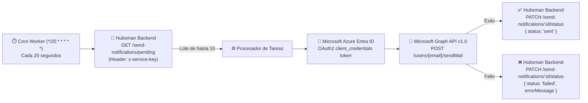

# Task Services Worker ⏱️📧

Microservicio en segundo plano encargado de la ejecución programada (Cron Worker) para despachar correos electrónicos pendientes mediante **Microsoft 365 (Microsoft Graph API v1.0)**, reemplazando proveedores tradicionales como Brevo.

## 🎯 Arquitectura y Flujo de Trabajo



1. **Planificador Cron:** Ejecuta cada 20 segundos (`*/20 * * * * *`) con control de bloqueo de concurrencia (`isProcessing`).
2. **Consulta de Cola FIFO:** Llama al backend de Hubsman (`GET /send-notifications/pending?limit=10`) usando autenticación de servicio en header `x-service-key`.
3. **Despacho Microsoft 365:** Envía cada mensaje por la API REST de Microsoft Graph (`sendMail`) con token OAuth2 en caché.
4. **Actualización de Estado:** Notifica al backend de Hubsman el resultado (`sent` o `failed`) para cada registro.

---

## 🛠️ Requisitos Previos

- **Node.js** >= 20.x (probado con v24.21.0)
- **Hubsman Backend** corriendo (por defecto en `http://localhost:5000` para `hubsman-v2`)
- Credenciales válidas de Microsoft Azure Entra ID / Office 365

---

## ⚙️ Variables de Entorno (`.env`)

```ini
# Configuración del Worker
PORT=5001
NODE_ENV=development

# Conexión con Hubsman Backend (hubsman-v2 en puerto 5000)
HUBSMAN_API_URL=http://localhost:5000
SERVICE_API_KEY=hubsman_task_service_secret_key_2026

# Tarea y Lotes
CRON_SCHEDULE=*/20 * * * * *
BATCH_SIZE=10

# Credenciales de Azure / Microsoft 365
AZURE_TENANT_ID=<TU_AZURE_TENANT_ID>
AZURE_CLIENT_ID=<TU_AZURE_CLIENT_ID>
AZURE_CLIENT_SECRET=<TU_AZURE_CLIENT_SECRET>
AZURE_MAIL_FROM=hubsmannotificaciones@hubsman.com
MAIL_FROM_NAME=Hubsman
MAIL_REPLY_TO=tecnologia@hubsman.com
```

---

## 🚀 Comandos

```bash
# Instalar dependencias
npm install

# Compilar proyecto TypeScript
npm run build

# Iniciar en modo desarrollo
npm run start:dev

# Iniciar en modo producción
npm run start:prod

# Probar envío de correo directo con Azure
npm run test:email -- tu_correo@dominio.com
```

---

## 📡 Endpoints HTTP

| Método | Endpoint | Descripción |
|---|---|---|
| `GET` | `/` | Estado general del servicio y configuración activa |
| `GET` | `/health` | Healthcheck (uptime, timestamp) |
| `GET` | `/tasks/status` | Métricas de ejecución (total procesados, enviados, fallidos, duración) |
| `POST` | `/tasks/trigger` | Disparo manual inmediato del ciclo de despacho |
